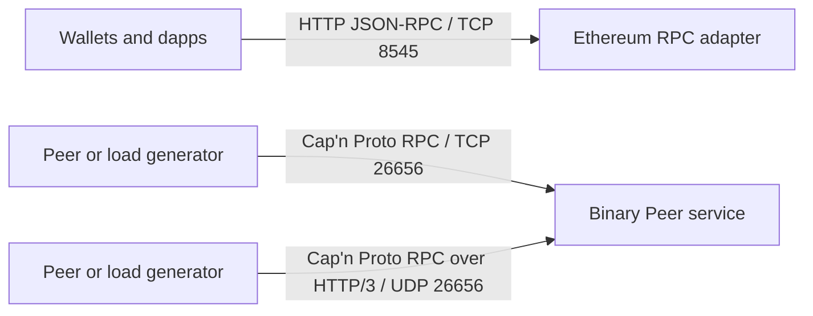
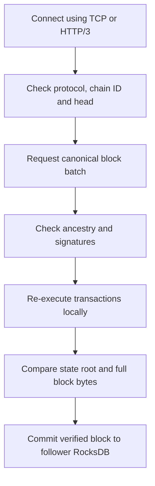
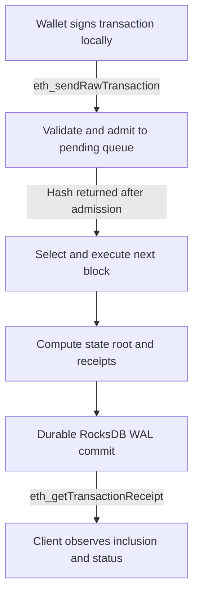

# SFC protocol — ports, HTTP/3, Cap’n Proto RPC and Ethereum RPC

This document describes the current development implementation. The canonical
Cap’n Proto schema is [chain.capnp](../crates/sfc/schema/chain.capnp); networking is
implemented in [network.rs](../crates/sfc/src/network.rs).

## Interfaces

SFC exposes an Ethereum JSON-RPC API for wallets and a binary Cap’n Proto RPC API
for peers and load generators. The binary API supports two transports: direct TCP
and HTTP/3 over QUIC/UDP. HTTP/3 carries the same Cap’n Proto methods and payloads
as direct TCP. Ethereum RPC uses its own HTTP listener and JSON-RPC messages.

### Ports and listeners

These are the defaults for a standalone node created with `sfc init`:

| Interface | Default address | Port / transport | Request format | Configuration field |
| --- | --- | --- | --- | --- |
| Ethereum RPC | `127.0.0.1:8545` | **8545 / TCP**, HTTP | `POST /`, JSON-RPC 2.0 | `rpc_listen` |
| Cap’n Proto RPC | `127.0.0.1:26656` | **26656 / TCP**, direct binary stream | Two-party `Peer` capability RPC | `capnp_listen`; defaults to `peer_listen` |
| HTTP/3 peer RPC | `127.0.0.1:26656` | **26656 / UDP**, QUIC with TLS | `POST /sfc/rpc`, `application/x-capnp` | `peer_listen` |

TCP and UDP have separate port namespaces, so the two peer listeners can both use
port **26656**. All three listeners start with the node. Choosing a follower's
`sync_peer.transport` selects its outgoing connection; it does not turn off the
other listener. New peer configurations and Rust benchmark runs default to `tcp`.

### Interface architecture



The dashboard shares the Ethereum HTTP listener, so it needs no extra port:

| HTTP route on port 8545 | Method | Response |
| --- | --- | --- |
| `/dashboard` | `GET` | HTML dashboard |
| `/dashboard/stats` | `GET` | Cap’n Proto `Value` with node and host statistics |
| `/dashboard/index` | `GET` | Cap’n Proto `Value` with explorer/search results |

Peer serving addresses are restricted to loopback. Ethereum/dashboard HTTP defaults
to loopback, but `rpc_listen` also accepts other bind addresses. `make stresstest`
and `make stressstart` use `0.0.0.0` for this shared HTTP listener by default;
`STRESS_BIND=127.0.0.1` selects local-only access. The HTTP listener has no built-in
TLS or authentication. These settings do not change the peer listener restrictions.

For `make testnet`, node `N` normally uses Ethereum port `8545 + N` and HTTP/3
port `26656 + N`. The supervisor assigns a separate available TCP peer port to each
node. `make testnet` connects followers over TCP; the supervisor CLI can select
HTTP/3 with `--sync-transport http3`. Read each node's `config.jsonl` for the actual
ports, especially when using custom base ports.

### Checking each interface

With a node running at the default addresses, run from the repository root:

```sh
# Ethereum JSON-RPC: HTTP over TCP 8545.
curl -s http://127.0.0.1:8545/ \
  -H 'Content-Type: application/json' \
  -d '{"jsonrpc":"2.0","id":1,"method":"eth_chainId","params":[]}'

# Cap’n Proto RPC: direct TCP 26656.
make peer-status TRANSPORT=tcp

# The same Peer.status method through HTTP/3 over UDP 26656.
make peer-status TRANSPORT=http3
```

The Ethereum call returns `{"jsonrpc":"2.0","id":1,"result":"0x1e61"}` for
the default chain ID, 7777. For a custom peer address, pass `PEER=host:port` to
`make peer-status`; for HTTP/3 also pass `CERT=/path/to/peer-cert.der` when the
server uses a different identity. The peer commands bootstrap Cap’n Proto RPC;
an ordinary JSON POST to `/sfc/rpc` does not invoke a peer method.

## HTTP/3 session

1. Connect using QUIC with TLS and ALPN `h3`.
2. Validate the server certificate against the configured certificate trust store
   and verify `server_name`. Generated self-signed certificates use `localhost`.
3. Send `POST /sfc/rpc` with `Content-Type: application/x-capnp`.
4. The server returns HTTP 200 and the same content type before request completion.
5. Use the request and response bodies as a full-duplex Cap’n Proto RPC stream.
6. Bootstrap the two-party server capability as `Peer`.

Wrong methods, paths, or content types receive HTTP 404. This is a streaming RPC
session, not an independent HTTP request for every Cap’n Proto method. Client
certificates are not required; the current design authenticates the server.

Quinn handles QUIC, rustls handles TLS, and h3/h3-quinn handle HTTP/3 framing.
A 256 KiB in-memory duplex bridge propagates transport backpressure. Active RPC
sessions have no fixed wall-clock expiry. The server allows ten seconds for the
QUIC handshake and configures a 30-second idle timeout. The follower reconnects
after disconnection. Status and block-batch calls have five-second client deadlines.
Sync retries wait one second; an idle follower polls every 100 ms.

## Configuration

A follower uses a `sync_peer` object in its editable `config.jsonl`. Use a text
editor or the Python adapter; see [v3 tooling](CAPNP-V3.md). Its fields are `transport`
(`tcp` for new peers), `address`, `server_name`, and `certificate`.

The default listener entries are:

```jsonl
{"rpc_listen":"127.0.0.1:8545"}
{"peer_listen":"127.0.0.1:26656"}
{"capnp_listen":null}
```

These are excerpts from a complete generated configuration. Stop the node before
editing and replace existing fields; duplicate top-level fields are rejected.
`capnp_listen: null` makes startup use `peer_listen` for the direct TCP socket.
To separate the peer ports, replace that line with:

```jsonl
{"capnp_listen":"127.0.0.1:26657"}
```

HTTP/3 then remains on UDP 26656, while direct Cap’n Proto RPC uses TCP 26657.
Ethereum RPC and the dashboard remain on TCP 8545.

All nodes must share the same genesis. Initialize each node's own identity and data
home, then copy the leader's genesis before starting a new follower. Relative
certificate paths are resolved against the config file's directory.

For a separate TCP port, set `"capnp_listen": "127.0.0.1:26657"` on the server
and set the follower's transport to `"tcp"` and address to that TCP listener. Keep
`server_name` and `certificate` fields in the configuration; TCP ignores them.
Direct TCP is unencrypted and both client and server addresses must be loopback.
For HTTP/3, explicitly set `"transport": "http3"` and use the UDP peer address
with the server's pinned certificate. There is no silent transport fallback.

For example, replace the follower's `sync_peer` line with one of these, adjusting
the certificate path to the sequencer's public certificate:

```jsonl
{"sync_peer":{"transport":"tcp","address":"127.0.0.1:26657","server_name":"localhost","certificate":"/path/to/sequencer/peer-cert.der"}}
```

```jsonl
{"sync_peer":{"transport":"http3","address":"127.0.0.1:26656","server_name":"localhost","certificate":"/path/to/sequencer/peer-cert.der"}}
```

The follower needs its own unused listener ports on the same host; `sync_peer.address`
is the sequencer's destination address, not a local bind address. `make testnet`
creates this layout automatically.

Both sync transports carry the same canonical Cap’n Proto block bytes retrieved
from storage. Ethereum RLP transaction bytes remain inside those blocks; JSON
encoding is confined to the Ethereum RPC boundary.

## Peer methods

| Method | Ordinal | Input | Output |
| --- | --- | --- | --- |
| `status` | 0 | None | `Status` |
| `submitTransaction` | 1 | Raw signed transaction bytes | Transaction hash bytes |
| `getBlock` | 2 | Height (`UInt64`) | `found` flag and `Block` |
| `getBlocks` | 3 | Start height and limit | Ordered list of `Block` |
| `getEncodedBlocks` | 4 | Start height and limit | Canonical storage block segments as `List(Data)` |
| `submitTransactions` | 5 | Raw signed transactions as `List(Data)` | Ordered transaction hash or error per entry |
| `account` | 6 | 20-byte address | Committed nonce and balance |
| `committedTransaction` | 7 | 32-byte transaction hash | Found flag, height, block hash and success |
| `verification` | 8 | None | Node PID, runtime and CPU/GPU verification counters |

`getBlock` returns `found=false` for missing/pruned heights. `getBlocks` starts at
the requested height, stops at a missing height, and clamps the requested limit to
64. Limit zero returns an empty list. Raw transaction bytes across a returned batch
are bounded near 2 MiB. Server validation failures surface as Cap’n Proto errors.

Submission means mempool admission, not finality or durable inclusion. Followers
reject transaction submission; clients must submit to the sequencer.

### Wire types

| Type | Fields |
| --- | --- |
| `Status` | `protocolVersion: UInt32`, `chainId: UInt64`, `height: UInt64`, `blockHash: Data`, `earliestHeight: UInt64` |
| `Block` | `chainId: UInt64`, `height: UInt64`, `timestamp: UInt64`, `parentHash: Data`, `stateRoot: Data`, `transactions: List(Data)` |

Current status protocol version is 3. Block timestamps are Unix seconds; adjacent
100 ms blocks can have equal timestamps. Parent and state hashes must be 32 bytes.
Transactions remain Ethereum-encoded signed bytes carried as opaque `Data`.
Production sync uses `getEncodedBlocks`, including receipts. The follower regenerates
all execution results and checks the complete canonical bytes before committing.
The older `getBlock`/`getBlocks` inspection methods omit receipts. A response is
limited to 64 blocks and targets 2 MiB; one larger bounded block can be returned
alone. Readers allow the storage record limit plus RPC framing overhead.

The schema also defines `Vote` with chain, height, round, phase, block hash,
validator, and signature. It is not exposed through an active consensus networking
method. Schema ordinals are wire identities: do not renumber existing fields or
methods when extending the protocol.

## Synchronization



A follower connects to its configured peer, reads status, and checks protocol
version and chain ID. If the required next height predates `earliestHeight`, sync
fails with a request to use an archive peer. At equal height, head hashes must
match. A behind upstream does not roll back the follower.

When behind, the follower requests batches beginning at its current height + 1.
For every block it checks chain ID, consecutive height, parent hash, payload limits,
and signed transactions. It re-executes transactions and compares the computed
state root before committing. Invalid ancestry, signatures, or roots are rejected.
Each accepted block commits independently: a failure later in a batch does not
undo earlier valid committed blocks. Catch-up resumes from the last committed head.

There is no automatic reorganization, multi-peer selection, snapshot import,
state-sync checkpoint, or validator finality certificate in this path. Followers
verify execution of their configured sequencer's history; this is not distributed
Byzantine consensus.

## Resource limits

| Resource | Limit |
| --- | ---: |
| Signed transaction | 128 KiB |
| Block transactions | 4096 / 2 MiB raw bytes |
| Pending raw transactions | 64 MiB; default 16384 entries |
| HTTP JSON-RPC body | 5 MiB |
| JSON-RPC batch | 4,096 entries |
| Peer connections per transport listener | 32 |
| Concurrent QUIC bidirectional streams per connection | 8 |
| Cap’n Proto traversal | 33,816,576 words (256 MiB storage record budget + 2 MiB framing) |
| Cap’n Proto nesting | 32 |
| Block response | Up to 64 blocks |

These are implementation bounds, not proof of resistance to arbitrary public
network traffic.

## Ethereum JSON-RPC

The default endpoint is **`http://127.0.0.1:8545/`**, configured by `rpc_listen`.
Clients send `Content-Type: application/json`. Requests use JSON-RPC 2.0 over
HTTP POST. Batches return responses in input order;
valid notifications execute without a reply, with HTTP 204 when no replies remain.
An empty batch or a batch over 4,096 entries is invalid. Parse errors use `-32700`,
invalid requests `-32600`, and unknown methods `-32601`.

Supported transaction formats are protected legacy EIP-155 and EIP-1559 type 2.
Execution uses Shanghai rules, a fixed zero base fee, and deterministic zero
PREVRANDAO. State reads support `latest`; block lookups also support `earliest`
and explicit heights. Missing or pruned block/receipt lookups return null.

| Use | Methods |
| --- | --- |
| Identify the chain and head | `eth_chainId`, `eth_blockNumber` |
| Inspect account state | `eth_getBalance`, `eth_getTransactionCount`, `eth_getCode`, `eth_getStorageAt` |
| Submit a client-signed transaction | `eth_sendRawTransaction` |
| Check execution results | `eth_getTransactionReceipt`, `eth_getBlockByNumber` with transaction hashes |
| Simulate contract execution | `eth_call`, `eth_estimateGas` |

Wallets sign transactions locally and submit them to the sequencer. A returned
transaction hash acknowledges admission; poll `eth_getTransactionReceipt` to see
durable inclusion and execution status. Followers serve reads and reject submission.

### Transaction flow



The hash response precedes the commit boundary. The receipt is available after
the transaction's block commits; a reverted EVM call has a failed execution status.

See [Ethereum compatibility](ETHEREUM.md) for the complete supported method list.
`eth_syncing` and `net_peerCount` currently return fixed values; they are not peer
health or lag telemetry. SFC uses its own commitments, not Ethereum trie proofs.

## Runtime records

Runtime records use [runtime.capnp](../crates/sfc/schema/runtime.capnp).
`Value` is a recursive typed union with sorted object keys, not a JSON string.
Genesis and dashboard replies contain standard unpacked Cap’n Proto messages.
Node configuration and the supervisor network manifest use JSONL. History, structured logs, benchmark streams and IPC prefix
each message with its UInt64 little-endian byte length. GPU IPC uses dedicated
`RecoveryRequest`/`RecoveryResponse` schemas with binary digest/signature/key fields.

Structured events are stored in `data/logs/node.capnp`; human diagnostics go to
stderr and the process manager's `node.log`. Segmented `history/*.capnp` is a
recoverable projection of RocksDB. SQLite indexes raw transactions as BLOBs and
Cap’n Proto block/receipt/log records, with separate SQL columns for search.

Block hashing uses canonical Cap’n Proto segments and the `sfc/block/v3/capnp`
domain. State roots use the [SFC Merkle Patricia trie](MERKLE-TRIE.md).
Raw block segments are shared by storage and RPC; history adds length framing. Internal Rust
structures and serde Value adapters remain in memory; this is not a zero-copy
execution engine. Ethereum RLP and cryptographic preimages retain their prescribed
binary encodings. Native database files and TLS certificates retain native formats.

## Verification

```sh
make test-http3
make test-rpc
make test-sync
```

Tests cover actual HTTP/3 negotiation, TLS identity rejection, routing, concurrent
RPC calls, bounded batches, transaction submission, replay, divergent/pruned peers,
and process restarts. See [architecture](ARCHITECTURE.md) for persistence semantics.

### Binary bulk submission

`Peer.submitTransactions @5` is shared by direct Cap'n Proto RPC/TCP and the
HTTP/3 `/sfc/rpc` tunnel. It accepts `List(Data)` containing original signed RLP
transactions, with no JSON or hexadecimal encoding on the wire. Batches contain
1–4,096 transactions, at most 2 MiB total and 128 KiB per transaction. Invalid
batch bounds reject the entire call before admission. Each result is an ordered
union of a transaction hash or an error; invalid individual transactions do not
prevent subsequent valid entries from being admitted. Duplicate pending
transactions retain the existing idempotent hash response. Followers reject writes.

Verification runs on a blocking worker outside the node state mutex, using the
configured CPU/GPU/HYBRID verifier. Ordered admission acquires the mutex only after
verification. The RPC reader's bytes are copied once into owned `Bytes` at this
worker boundary. This is not an end-to-end zero-copy claim. An acknowledgement
means mempool admission, not commitment. `committedTransaction @7` checks durable
receipts; `account @6` reads committed nonce/balance. `verification @8` exposes
runtime/counters without JSON serialization. Existing method ordinals are unchanged;
this additive network API does not change stored blocks or chain hashes.

The Rust benchmark uses these capabilities for submission, commit polling, account
checks and GPU counters. A persistent connection is reused per node. HTTP/3 uses
the same Cap'n Proto RPC method and payload over QUIC/TLS; direct TCP remains
loopback-only and unencrypted. Compare these concrete implementations rather than
interpreting the measurements as a universal comparison of serialization formats.
