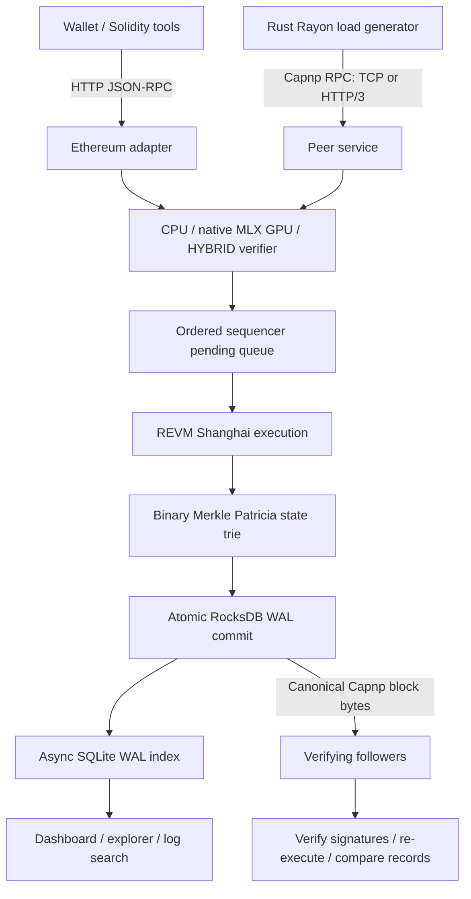
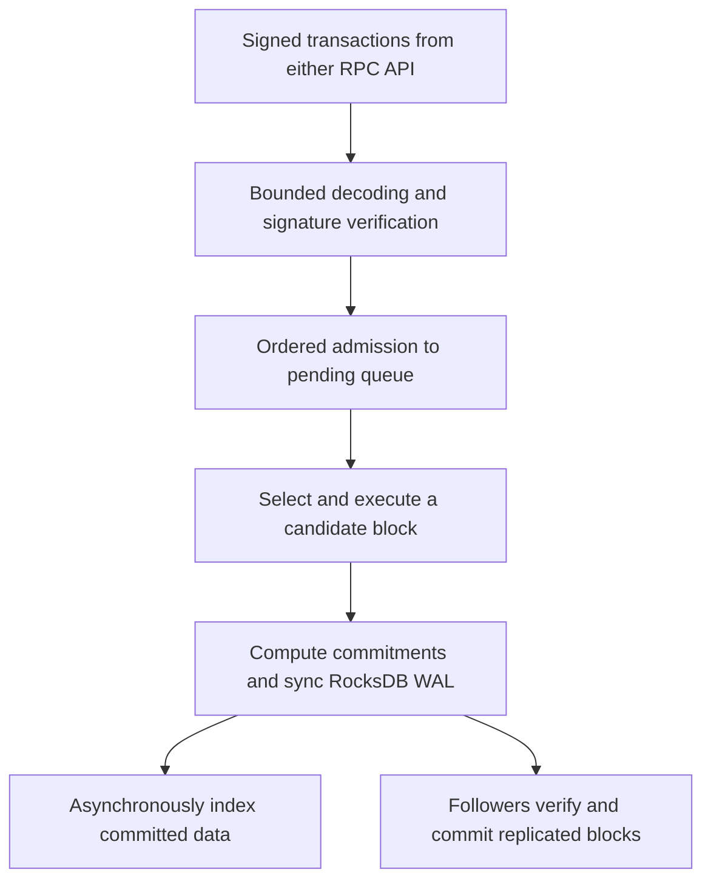

# Super Frontier Chain — implementation specification

Status: development implementation, 2026-10-21. This document describes the current
Rust code, not a production L1 or full Ethereum conformance claim. Wire schemas
are authoritative: `crates/sfc/schema/chain.capnp`, `storage.capnp`, `runtime.capnp`.

For listener ports, HTTP/3, Cap’n Proto RPC, Ethereum RPC, configuration and command
examples, see the [protocol guide](PROTOCOL.md#ports-and-listeners).

## 1. Architecture



The sequencer orders transactions and creates blocks. Followers accept replicated
blocks and verify execution; they reject transaction submission and cannot produce
blocks. Consensus voting, certificates and locking primitives exist separately, but
there is **no integrated distributed BFT reactor or validator failover** in the
running node. Local durable commit is not multi-validator finality.

Rust owns execution, networking, verification and benchmark generation. Native MLX
runs inside the node process through MLX-C custom integer GPU kernels. Metal is an
alternative GPU runtime. CPU and HYBRID modes remain available. GPU failures reject
the operation; they do not silently fall back to CPU. Python is only supervisor and
control tooling, outside the measured execution/verification path.

## 2. Transaction and block flow



1. Receive Ethereum signed RLP transaction bytes (protected legacy or type 2).
2. Validate batch and payload bounds. Reserve ordered admission capacity before
   launching verification; overloaded requests fail without starting a GPU task.
3. Parse fields required by EVM/signature verification, enforce chain ID and
   signature rules, recover signers using the configured backend.
4. Admit results in request order. Each batch entry returns its own hash/error;
   malformed entries cannot shift signer/result pairing. Followers are read-only.
5. The sequencer executes selected transactions against a candidate state, with
   block gas/byte/count limits. Failed candidate state never becomes committed state.
6. Update the Merkle root, build canonical Capnp block bytes containing transactions
   and receipts, and link the previous block hash.
7. Atomically commit state, head, block and transaction lookup indices to RocksDB
   with synchronous WAL. Publish the new in-memory head only after durability.
8. SQLite indexes committed blocks, transactions, receipts and logs asynchronously.
   Index lag is visible; indexing completion is not the commit boundary.
9. Followers obtain encoded blocks, borrow transaction slices, verify and execute,
   then compare reconstructed canonical records with the received block before commit.

Restart rebuilds the derived trie from stored state and checks the committed head's
state root. History projections are repairable; pruning removes old block/receipt
history according to configured retention. It does not reset current account state.

## 3. Byte ownership and memory copies

Canonical Capnp blocks use `bytes::Bytes` ownership and borrowed Readers. Storage,
sync and indexing read fields directly; they do not require a generic JSON value or
materialized Rust block object. `Bytes` clones/slices share the original allocation.

Bulk RPC params are local-task owned. Before dispatch to a blocking verifier, their
raw transaction payloads are copied once into a shared batch slab, then represented
as Bytes slices. This replaces a payload allocation per transaction with one per
batch. A slice keeps its backing batch alive until all slices are released; this is
a memory-retention tradeoff, not a claim of lower live memory in every workload.
Partially admitted batches detach surviving raw bytes; revalidation drops likewise
detach remaining pending payloads so rejected neighbors cannot keep large slabs alive.

GPU preparation borrows signature-recovery records instead of cloning every digest
and signature into a second vector. Required integer packing still writes a reused
Rust staging buffer; MLX-C `mlx_array_new_data` then copies it into an MLX-owned array.
This is **not end-to-end zero-copy GPU execution**. The managed-array C API is not
assumed to be zero-copy or safe for arbitrary Rust allocations without validation.

EVM execution still materializes numeric transaction/state fields. World account
maps, REVM backing state, receipt construction and canonical message construction
still allocate/copy. Capnp storage alone does not remove these costs.

## 4. State commitment and persistence

SFC uses a compressed binary Merkle Patricia trie with Keccak-256, domain-separated
empty/leaf/branch hashes, and deterministic split-bit ordering. Account leaves hold
canonical Capnp account bytes; module state and the EVM BLOCKHASH window have separate
key namespaces. Unchanged branches are shared and only changed paths are rehashed.

Account storage is currently inside each account value. A per-contract storage trie
and dirty-slot execution path are **not implemented yet**. Change detection still
scans public World maps. Proofs are available through Rust APIs, not `eth_getProof`.
See [exact hash format and limitations](MERKLE-TRIE.md).

RocksDB and SQLite support explicit forward schema migrations and reject unknown
newer schemas. Changing consensus commitment format cannot silently migrate old
block hashes: old flat-hash homes are preserved and rejected by the Merkle binary.
SQLite uses WAL and contains a rebuildable index, not consensus-authoritative state.

## 5. Peer protocol: Cap'n Proto RPC

Both transports expose the same `Peer` capability and typed methods:

| Ordinal | Method | Input / result |
| --- | --- | --- |
| 0 | status | protocol version, chain ID, head height/hash, earliest height |
| 1 | submitTransaction | raw RLP Data → hash |
| 2 | getBlock | height → found + typed block |
| 3 | getBlocks | start/limit → typed blocks |
| 4 | getEncodedBlocks | start/limit → canonical storage block Data list |
| 5 | submitTransactions | List(Data) → ordered List(hash or error) |
| 6 | account | 20-byte address → nonce and balance Data |
| 7 | committedTransaction | 32-byte hash → found/height/blockHash/success |
| 8 | verification | process/runtime and CPU/GPU counters |

`getEncodedBlocks` is the replication path carrying full canonical records including
receipts. Older typed Block views are not interchangeable with storage Block bytes.
Bulk submissions permit 1–4,096 entries, at most 128 KiB per transaction and 2 MiB
aggregate raw payload. Block retrieval caps requested count at 64 and applies the
server's response byte budget. Admission is bounded (two queued jobs plus one active
job). Wire/schema compatibility and consensus commitment compatibility are distinct.

### TCP (default)

Capnp two-party RPC over a reliable TCP stream. The direct TCP endpoint is restricted
to loopback and is unencrypted. Do not expose it as a public authenticated endpoint.
Persistent sessions have no fixed wall-clock expiry. TCP is the default because it
was faster in the documented local measurements; that is not a WAN guarantee.

### HTTP/3 (optional)

A full-duplex HTTP/3 `POST /sfc/rpc`, with `Content-Type: application/x-capnp`, tunnels
the same Capnp RPC byte stream in request/response DATA. QUIC/TLS provides transport
security; clients pin the configured peer certificate and server name. HTTP/3 is
not a JSON RPC protocol and does not define a different transaction encoding.

Connections are bounded, handshakes have a deadline, and QUIC idle timeouts apply.
Active RPC sessions are long-lived. Configure advertised endpoints and certificate
trust explicitly; discover actual test endpoints in startup output.

## 6. Ethereum-compatible HTTP RPC

HTTP `POST /` accepts JSON-RPC 2.0, individual requests, notifications and batches
of 1–4,096 requests. HTTP body limit: 5 MiB. This is a compatibility adapter, separate
from the high-throughput binary peer API.

| Category | Implemented methods |
| --- | --- |
| Identity | web3_clientVersion, web3_sha3, net_version, net_listening, net_peerCount |
| Chain | eth_chainId, eth_blockNumber, eth_syncing, eth_accounts |
| Fees | eth_gasPrice, eth_maxPriorityFeePerGas |
| State | eth_getBalance, eth_getTransactionCount, eth_getCode, eth_getStorageAt |
| Transactions | eth_sendRawTransaction, eth_getTransactionReceipt |
| Blocks | eth_getBlockByNumber (transaction hashes only; second argument false) |
| Simulation | eth_call, eth_estimateGas |
| SFC extension | sfc_verificationStatus |

State queries accept latest state only. Block queries support latest, earliest and
hex height; pruned/missing blocks and receipts return null. Pending/safe/finalized
tags are not supported. Peer count and syncing responses are development values,
not BFT connectivity/finality telemetry. eth_accounts is empty: clients hold keys.

REVM executes Shanghai bytecode; compile Solidity with `evmVersion: "shanghai"`.
Contract creation, calls, storage, logs, reverts and ERC-20 operations are tested.
Fees use zero base fee and a zero-address beneficiary, not Ethereum's dynamic fee
market. Unsupported: type-1/blob/authorization-list transactions, eth_getLogs,
eth_getTransactionByHash, filters/subscriptions, tracing, full block transaction
objects, historical account state and Ethereum MPT proofs. Unknown methods return
method-not-found. Cronos-level tooling compatibility is a goal, not a completed
conformance claim. See [compatibility details](ETHEREUM.md).

## 7. Stress defaults and interpretation

`make stresstest`: release build, one sequencer, native MLX GPU, SQLite ON, Capnp TCP,
12 Rayon workers, 4,096-entry batches, one in-flight batch, 10 ms block scheduling,
1,048,576 transactions per round. Runs until `make stop` or Ctrl-C. Startup prints
URLs and persistence paths. Home: `~/.superfrontierchain/stress`; old homes are preserved.

Python supervises the build and Rust runner lifecycle; no benchmark computation or
GPU execution runs in Python. `make stressstart` starts the same workload in the
background. Supervisor output is appended to `~/.superfrontierchain/supervisor/stress.log`. Duplicate
starts return successfully without starting another runner. `make stop` discovers
this repository's current-user blockchain processes and supervisors, terminates
their descendants, waits for exit and escalates to SIGKILL after a grace period.
Custom data homes are discovered through process identity, not guessed PID files.
State directories are retained. Test with `make test-stress-supervisor` when no
other repository blockchain processes are running.

TPS counts committed transfers and includes signature verification, EVM execution,
Merkle updates and durable commits. Fixture signing is outside the timed interval.
Node CPU uses 100% per core and excludes the load generator. SQLite catches up
asynchronously and is checked after timing. These local transfer tests are neither
order-book benchmarks nor sustained multi-validator consensus throughput.

## 8. Remaining optimization targets (not implemented)

See [byte-pipeline measurements](BYTE-PIPELINE-BENCHMARK.md) for the current changes:
allocation/copy reductions are implemented, but a stable TPS improvement is not established.

1. EVM state conversion: `ethereum::load_db` reconstructs the numeric account/storage
   database and `save_db` reconstructs World accounts. Track dirty accounts/slots and
   reuse unchanged canonical records instead of repeatedly parsing/stringifying them.
2. Storage commitments: separate each contract's storage trie from its account leaf;
   update only written slots and the account's storageRoot. This changes commitment
   rules and needs an explicit compatibility plan, deterministic vectors and replay tests.
3. GPU input ownership: eliminate the staging-to-MLX copy only with a documented,
   GPU-compatible allocation and correct ownership through lazy/asynchronous execution.
   Never pass a temporary Rust pointer whose storage may be reused before GPU completion.
4. Block construction/import: production constructs canonical bytes; followers currently
   reconstruct execution records for comparison. Investigate streaming comparison of
   expected fields without losing receipt, ordering or canonical-byte validation.
5. Evaluate large state and contracts: small-account transfer TPS does not expose the
   cost of large storage maps, touched-slot distributions or state snapshot copying.
   Compare paired runs, CPU usage, allocations/live memory and commit latency as well as TPS.

## 9. Execution-path allocation improvements

See [alternating before/after measurements](EXECUTION-ALLOCATION-BENCHMARK.md).

The EVM change set is applied in deterministic address order using a sorted contiguous
vector instead of temporary B-tree nodes. Stable sorting and duplicate-key handling
preserve the previous last-entry-wins behavior; storage slots are sorted before apply.
That allocation optimization constructed the then-current `tx/` plus 64 lowercase
hex-byte keys in a stack buffer. Chain schema 3 now writes `tx/` plus 32 raw hash
bytes and an eight-byte height, while retaining reads of the earlier format; see
[storage migrations](STORAGE-MIGRATIONS.md).

Single-transaction Capnp RPC now reserves the same ordered admission queue as bulk
RPC and runs verification on a blocking worker. It no longer performs GPU work while
holding the node lock on the RPC executor. Mixed single/bulk requests preserve their
arrival order within the same Peer capability; this is not a global cross-client
ordering guarantee.

Rust-generated benchmark transactions stay as Bytes through request construction;
there is no raw-bytes → hex-text → raw-bytes round trip. Historical hex fixture files
remain loadable and are decoded once at load time. This reduces load-generator work,
which is outside the reported node CPU/timed signing interval.

### Remote stress dashboard

The Python-supervised stress targets default to `STRESS_BIND=0.0.0.0`.
This exposes the shared dashboard and Ethereum HTTP RPC listener on IPv4
interfaces; internal benchmark requests still use loopback. Startup reports
local and network dashboard URLs, including the Tailscale IPv4 URL when
available. An iPad must share the LAN or have permitted access through Tailscale.
Set `STRESS_BIND=127.0.0.1` to restrict HTTP access to this machine.
Direct benchmark runs retain a loopback default unless `--rpc-bind` is supplied.


### JSONL settings and short retention

Persistence defaults to `~/.superfrontierchain`, with separate `node/`,
`stress/node-0/`, `testnet/` and `supervisor/` directories. Node settings
are in `config.jsonl`, one top-level field per JSON line. Edit and restart:

```jsonl
{"retention":{"mode":"pruned","seconds":60}}
```

The default is **60 seconds**, configurable as a positive integer; archive mode
is explicit. Existing configuration values are preserved when loading old homes.
Legacy Cap’n Proto configs remain readable and are preserved during JSONL migration.
Genesis and chain/network data remain Cap’n Proto.

RocksDB expires blocks and receipt indexes relative to the committed head timestamp.
SQLite uses WAL and appends indexed blocks, transactions, receipts and logs without
pruning them. Its history is independent of RocksDB retention; blocks pruned
before indexing can still be skipped and are reported by the index cursor.
Current state remains. Projection segments rotate at min(retention seconds, 60),
so a partial boundary segment can retain up to one additional segment. RocksDB
reclaims physical space during compaction; SQLite history continues to grow.
Raw diagnostic logs and benchmark reports have separate lifetimes; retention
is not a total disk-size limit.

## 10. Shared hashes and bounded block reads — 2026-10-22

Block clones share their lazy Keccak cache as well as their immutable Cap'n Proto
bytes. Computing a hash in the durable head cache now initializes the producer,
logging and subsequent-parent views too, including clones created before hashing.
The hash domain, canonical bytes and consensus rules are unchanged.

Local block construction checks transaction count, receipt count and byte bounds
before allocating its arena. Fixed-width hashes and Rust strings guarantee the
remaining width/UTF-8 invariants; log hex is checked while writing. Canonicalization
still uses `set_root_canonical`. Ordinary locally built blocks avoid a second full
wire scan. Records larger than 32 MiB retain full reader validation to preserve
traversal-budget acceptance. All incoming network and persisted bytes retain the
complete canonical and structural checks. Index receipt records are canonicalized
directly from their borrowed reader, avoiding an intermediate receipt arena.

The three block-read RPC methods use blocking workers and a shared Store, without
holding the Node mutex. A RocksDB snapshot and cached head are captured together
under the store's head lock; the lock is released before disk reads and validation.
The snapshot preserves a consistent batch while commits/pruning proceed. Existing
64-block and approximately 2 MiB batch bounds remain, allowing one larger first
block. Each connection allows two active block reads; a worker retains its permit
even when its caller is cancelled, through completion and response construction.

GPU runtime remains native MLX, with the existing kernels, 2,048-record crossover,
50-microsecond completion polling and CPU/GPU/HYBRID rules. A focused benchmark
checks CPU-equivalent transactions and measures native verification at small,
large and crossover batches, excluding signing, network, execution and disk:

```sh
RAYON_NUM_THREADS=12 cargo run --offline --locked --release --example verification_benchmark
```

### Measurements and remaining throughput limit

[Raw results and methodology](hash-capnp-results-2026-10-22.json) retain all trials,
binary hashes, codec allocations, GPU latency and diagnostic exclusions.
In an isolated release codec run (4,096 transfers, seven samples), local block
construction fell from **863.1 to 478.2 microseconds (44.6% less time)**. Incoming
block validation remained approximately 389/384 microseconds. Sharing the hash
cache adds one 56-byte allocation per constructed/imported block; borrowed field
reads still allocate nothing.

This is **not a demonstrated end-to-end throughput improvement**. Three alternating
million-transfer pairs, native MLX, TCP, SQLite ON, 12 Rayon workers and a 10 ms
scheduler produced:

| Pair | Before committed TPS | After committed TPS |
| --- | ---: | ---: |
| 1 | 257,666 | 206,202 |
| 2 | 258,726 | 204,907 |
| 3 | 210,673 | 256,699 |
| Median | 257,666 | 206,202 |

The primary median is **20.0% lower**. Median node CPU time per transfer changed
from 10.66 to 10.48 microseconds and post-commit SQLite catch-up from 10.09 to
9.93 seconds. Both binaries also showed approximately 200k/260k TPS modes in
additional diagnostics, so these changes must not be advertised as a throughput
win or a sustained-capacity measurement.

A separate persistent-run diagnostic recorded 7 versus 137 empty blocks between
its first and last full transaction blocks (256 full blocks in each run). That
pair achieved 260,172 versus 255,418 TPS with lower node CPU in the candidate.
This motivates investigation of timer/admission interaction; it does not isolate
the cause of the primary regression. Empty-block scheduling policy is unchanged.
The first extra reverse-order candidate trial briefly overlapped an earlier
codec run; those diagnostic trials are excluded from the primary comparison.

Validation passed: 82 standard release tests; native MLX differential tests;
CPU/GPU/HYBRID order, error and state/replay parity; three native benchmark,
recovery and replication tests; release Clippy with warnings denied; formatting
and whitespace checks. The new RPC regression holds the execution mutex while
all three block-read methods complete over both TCP and HTTP/3.

## 11. Throughput stall investigation and follow-up (2026-10-22)

[Raw trials, phase timings and exclusions](tps-investigation-2026-10-22.json)
record the follow-up to section 10. Temporary diagnostic builds buffered timing
records in memory and wrote them on exit. Final throughput runs use the ordinary
release executable without those probes.

### Cause and persistence change

The slow mode reproduced with nearly unchanged verification and block execution
time. In one fast/slow pair, total history projection sync time increased from
136 to 977 ms; individual syncs averaged 3.8 versus 26.4 ms and reached 114 ms.
These syncs ran inside `Node::produce`, holding the execution mutex and delaying
admission. Both modes produced similar numbers of empty blocks, so empty-block
count was not a sufficient explanation.

A background-fsync prototype did not remove the slowdown: in a slow traced run,
RocksDB commit time increased from about 4.3 to 6.8 ms per full block, with an
86 ms maximum. The measurements are consistent with storage contention moving
between the two writers; they do not identify the underlying device/OS cause of
variable fsync latency. The prototype was discarded.

The retained implementation removes the projection's periodic 100 ms / 8 MiB
sync. History records are still appended immediately and synced on segment close
and clean shutdown. The authoritative RocksDB WAL still synchronously commits
every block before acknowledgment; its options and the signing journal are
unchanged. A crash may lose more projection bytes, which restart reconstructs
from retained RocksDB blocks. A regression test SIGKILLs a writer after 32 blocks
and 32,768 transactions, removes all history files (over 8 MiB), and verifies
recovered blocks, world state and transaction lookup.

SQLite catch-up now reads its earliest height and bounded block batch from a
single RocksDB snapshot. It neither waits for nor holds the Node mutex during
block reads/validation. The 16-block / approximately 8 MiB batch limit and atomic
SQLite row/cursor commits remain. A regression holds the execution mutex while
the indexer catches up to a newly committed block.

### Native MLX dispatch

The MLX runtime and kernel arithmetic remain unchanged. Measurements of the two
existing paths favor cooperative recovery through 2,560 records on this M5 Max;
at 2,816 and 4,096 records the direct path is faster. The native MLX crossover is
therefore 2,560; direct Metal's selection is unchanged. CPU differential checks
include 2,559/2,560/2,561 as well as the former boundary.

| Batch | Previous selection | Cooperative path | Latency reduction |
| --- | ---: | ---: | ---: |
| 2,049 | 8.406 ms | 7.154 ms | 14.9% |
| 2,304 | 8.438 ms | 7.331 ms | 13.1% |
| 2,560 | 8.456 ms | 7.487 ms | 11.5% |

These are total native verification microbenchmarks, including CPU preparation
and GPU wait, with nine samples of ten iterations. They exclude RPC, execution
and storage. The 4,096-record end-to-end workload uses the same direct GPU path
before and after, so its throughput change is not attributed to this crossover.

### Final paired throughput and validation

Four pairs alternate AB/BA order. The baseline already includes section 10's
Capnp optimizations; the candidate adds the changes in this section. Both use
1,048,576 transfers, 4,096 records per RPC, inflight 1, 10 ms scheduling, one node,
TCP, native MLX, SQLite ON and 12 Rayon threads. Signing is outside timing;
verification, execution and durable RocksDB commit are inside. Index catch-up is
measured afterward.

| Pair | Before TPS | After TPS | Paired improvement |
| --- | ---: | ---: | ---: |
| 1 | 258,254 | 270,617 | 4.8% |
| 2 | 209,945 | 214,793 | 2.3% |
| 3 | 255,328 | 269,234 | 5.4% |
| 4 | 213,226 | 267,705 | 25.5% |

All four pairs improved; the median of the **paired improvements is 5.1%**.
The ratio of the separate TPS medians is larger: 234,277 to 268,470, or 14.6%.
The difference reflects the fast/slow execution modes and must not be presented
as a uniform 14.6% gain. Median CPU time per transfer decreased from 10.18 to
9.97 microseconds; median post-commit SQLite catch-up decreased from 9.98 to 9.63 s.
The remaining 214,793 TPS candidate run shows that the low-throughput mode was
not completely eliminated.

A separate persistent-node check completed three million-transfer rounds at
270,139 / 270,033 / 270,909 TPS. Each round signs before timing and does not wait
for SQLite catch-up before the next round. Its fixture differs from the paired
runs, so it is not included in those statistics. Neither experiment establishes
long-term saturated capacity, large-contract-state or multi-host throughput.

Validation passed: 84 standard release tests, native MLX differential tests at
the new crossover, CPU/GPU/HYBRID state and replay parity, all three native
benchmark/recovery/replication tests, release Clippy with warnings denied, format
and whitespace checks. No temporary tracing or experimental environment switches
are present in the production source.

```sh
RAYON_NUM_THREADS=12 target/release/sfc-bench bench \
  --binary /path/to/sfc --transactions 1048576 --rpc-batch 4096 \
  --inflight 1 --interval 10 --repeat 1 --sqlite on --output /tmp/result.capnp
# Alternate the retained before/after release binaries for paired comparisons.
```
