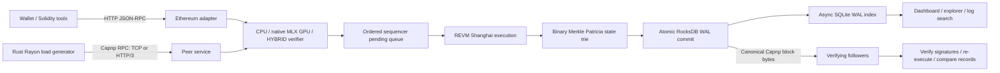

# Super Frontier Chain — implementation specification

Status: development implementation, 2026-10-21. This document describes the current
Rust code, not a production L1 or full Ethereum conformance claim. Wire schemas
are authoritative: `crates/sfc/schema/chain.capnp`, `storage.capnp`, `runtime.capnp`.

## 1. Architecture

The sequencer orders transactions and creates blocks. Followers accept replicated
blocks and verify execution; they reject transaction submission and cannot produce
blocks. Consensus voting, certificates and locking primitives exist separately, but
there is **no integrated distributed BFT reactor or validator failover** in the
running node. Local durable commit is not multi-validator finality.

Rust owns execution, networking, verification and benchmark generation. Native MLX
runs inside the node process through MLX-C custom integer GPU kernels. Metal is an
alternative GPU runtime. CPU and HYBRID modes remain available. GPU failures reject
the operation; they do not silently fall back to CPU. Python is only supervisor and
control tooling, outside the measured execution/verification path.

## 2. Transaction and block flow

1. Receive Ethereum signed RLP transaction bytes (protected legacy or type 2).
2. Validate batch and payload bounds. Reserve ordered admission capacity before
   launching verification; overloaded requests fail without starting a GPU task.
3. Parse fields required by EVM/signature verification, enforce chain ID and
   signature rules, recover signers using the configured backend.
4. Admit results in request order. Each batch entry returns its own hash/error;
   malformed entries cannot shift signer/result pairing. Followers are read-only.
5. The sequencer executes selected transactions against a candidate state, with
   block gas/byte/count limits. Failed candidate state never becomes committed state.
6. Update the Merkle root, build canonical Capnp block bytes containing transactions
   and receipts, and link the previous block hash.
7. Atomically commit state, head, block and transaction lookup indices to RocksDB
   with synchronous WAL. Publish the new in-memory head only after durability.
8. SQLite indexes committed blocks, transactions, receipts and logs asynchronously.
   Index lag is visible; indexing completion is not the commit boundary.
9. Followers obtain encoded blocks, borrow transaction slices, verify and execute,
   then compare reconstructed canonical records with the received block before commit.

Restart rebuilds the derived trie from stored state and checks the committed head's
state root. History projections are repairable; pruning removes old block/receipt
history according to configured retention. It does not reset current account state.

## 3. Byte ownership and memory copies

Canonical Capnp blocks use `bytes::Bytes` ownership and borrowed Readers. Storage,
sync and indexing read fields directly; they do not require a generic JSON value or
materialized Rust block object. `Bytes` clones/slices share the original allocation.

Bulk RPC params are local-task owned. Before dispatch to a blocking verifier, their
raw transaction payloads are copied once into a shared batch slab, then represented
as Bytes slices. This replaces a payload allocation per transaction with one per
batch. A slice keeps its backing batch alive until all slices are released; this is
a memory-retention tradeoff, not a claim of lower live memory in every workload.
Partially admitted batches detach surviving raw bytes; revalidation drops likewise
detach remaining pending payloads so rejected neighbors cannot keep large slabs alive.

GPU preparation borrows signature-recovery records instead of cloning every digest
and signature into a second vector. Required integer packing still writes a reused
Rust staging buffer; MLX-C `mlx_array_new_data` then copies it into an MLX-owned array.
This is **not end-to-end zero-copy GPU execution**. The managed-array C API is not
assumed to be zero-copy or safe for arbitrary Rust allocations without validation.

EVM execution still materializes numeric transaction/state fields. World account
maps, REVM backing state, receipt construction and canonical message construction
still allocate/copy. Capnp storage alone does not remove these costs.

## 4. State commitment and persistence

SFC uses a compressed binary Merkle Patricia trie with Keccak-256, domain-separated
empty/leaf/branch hashes, and deterministic split-bit ordering. Account leaves hold
canonical Capnp account bytes; module state and the EVM BLOCKHASH window have separate
key namespaces. Unchanged branches are shared and only changed paths are rehashed.

Account storage is currently inside each account value. A per-contract storage trie
and dirty-slot execution path are **not implemented yet**. Change detection still
scans public World maps. Proofs are available through Rust APIs, not `eth_getProof`.
See [exact hash format and limitations](MERKLE-TRIE.md).

RocksDB and SQLite support explicit forward schema migrations and reject unknown
newer schemas. Changing consensus commitment format cannot silently migrate old
block hashes: old flat-hash homes are preserved and rejected by the Merkle binary.
SQLite uses WAL and contains a rebuildable index, not consensus-authoritative state.

## 5. Peer protocol: Cap'n Proto RPC

Both transports expose the same `Peer` capability and typed methods:

| Ordinal | Method | Input / result |
| --- | --- | --- |
| 0 | status | protocol version, chain ID, head height/hash, earliest height |
| 1 | submitTransaction | raw RLP Data → hash |
| 2 | getBlock | height → found + typed block |
| 3 | getBlocks | start/limit → typed blocks |
| 4 | getEncodedBlocks | start/limit → canonical storage block Data list |
| 5 | submitTransactions | List(Data) → ordered List(hash or error) |
| 6 | account | 20-byte address → nonce and balance Data |
| 7 | committedTransaction | 32-byte hash → found/height/blockHash/success |
| 8 | verification | process/runtime and CPU/GPU counters |

`getEncodedBlocks` is the replication path carrying full canonical records including
receipts. Older typed Block views are not interchangeable with storage Block bytes.
Bulk submissions permit 1–4,096 entries, at most 128 KiB per transaction and 2 MiB
aggregate raw payload. Block retrieval caps requested count at 64 and applies the
server's response byte budget. Admission is bounded (two queued jobs plus one active
job). Wire/schema compatibility and consensus commitment compatibility are distinct.

### TCP (default)

Capnp two-party RPC over a reliable TCP stream. The direct TCP endpoint is restricted
to loopback and is unencrypted. Do not expose it as a public authenticated endpoint.
Persistent sessions have no fixed wall-clock expiry. TCP is the default because it
was faster in the documented local measurements; that is not a WAN guarantee.

### HTTP/3 (optional)

A full-duplex HTTP/3 `POST /sfc/rpc`, with `Content-Type: application/x-capnp`, tunnels
the same Capnp RPC byte stream in request/response DATA. QUIC/TLS provides transport
security; clients pin the configured peer certificate and server name. HTTP/3 is
not a JSON RPC protocol and does not define a different transaction encoding.

Connections are bounded, handshakes have a deadline, and QUIC idle timeouts apply.
Active RPC sessions are long-lived. Configure advertised endpoints and certificate
trust explicitly; discover actual test endpoints in startup output.

## 6. Ethereum-compatible HTTP RPC

HTTP `POST /` accepts JSON-RPC 2.0, individual requests, notifications and batches
of 1–4,096 requests. HTTP body limit: 5 MiB. This is a compatibility adapter, separate
from the high-throughput binary peer API.

| Category | Implemented methods |
| --- | --- |
| Identity | web3_clientVersion, web3_sha3, net_version, net_listening, net_peerCount |
| Chain | eth_chainId, eth_blockNumber, eth_syncing, eth_accounts |
| Fees | eth_gasPrice, eth_maxPriorityFeePerGas |
| State | eth_getBalance, eth_getTransactionCount, eth_getCode, eth_getStorageAt |
| Transactions | eth_sendRawTransaction, eth_getTransactionReceipt |
| Blocks | eth_getBlockByNumber (transaction hashes only; second argument false) |
| Simulation | eth_call, eth_estimateGas |
| SFC extension | sfc_verificationStatus |

State queries accept latest state only. Block queries support latest, earliest and
hex height; pruned/missing blocks and receipts return null. Pending/safe/finalized
tags are not supported. Peer count and syncing responses are development values,
not BFT connectivity/finality telemetry. eth_accounts is empty: clients hold keys.

REVM executes Shanghai bytecode; compile Solidity with `evmVersion: "shanghai"`.
Contract creation, calls, storage, logs, reverts and ERC-20 operations are tested.
Fees use zero base fee and a zero-address beneficiary, not Ethereum's dynamic fee
market. Unsupported: type-1/blob/authorization-list transactions, eth_getLogs,
eth_getTransactionByHash, filters/subscriptions, tracing, full block transaction
objects, historical account state and Ethereum MPT proofs. Unknown methods return
method-not-found. Cronos-level tooling compatibility is a goal, not a completed
conformance claim. See [compatibility details](ETHEREUM.md).

## 7. Stress defaults and interpretation

`make stresstest`: release build, one sequencer, native MLX GPU, SQLite ON, Capnp TCP,
12 Rayon workers, 4,096-entry batches, one in-flight batch, 10 ms block scheduling,
1,048,576 transactions per round. Runs until `make stop` or Ctrl-C. Startup prints
URLs and persistence paths. Home: `.sfc-stress-merkle-v1`; old homes are preserved.

TPS counts committed transfers and includes signature verification, EVM execution,
Merkle updates and durable commits. Fixture signing is outside the timed interval.
Node CPU uses 100% per core and excludes the load generator. SQLite catches up
asynchronously and is checked after timing. These local transfer tests are neither
order-book benchmarks nor sustained multi-validator consensus throughput.

## 8. Remaining optimization targets (not implemented)

See [byte-pipeline measurements](BYTE-PIPELINE-BENCHMARK.md) for the current changes:
allocation/copy reductions are implemented, but a stable TPS improvement is not established.

1. EVM state conversion: `ethereum::load_db` reconstructs the numeric account/storage
   database and `save_db` reconstructs World accounts. Track dirty accounts/slots and
   reuse unchanged canonical records instead of repeatedly parsing/stringifying them.
2. Storage commitments: separate each contract's storage trie from its account leaf;
   update only written slots and the account's storageRoot. This changes commitment
   rules and needs an explicit compatibility plan, deterministic vectors and replay tests.
3. GPU input ownership: eliminate the staging-to-MLX copy only with a documented,
   GPU-compatible allocation and correct ownership through lazy/asynchronous execution.
   Never pass a temporary Rust pointer whose storage may be reused before GPU completion.
4. Block construction/import: production constructs canonical bytes; followers currently
   reconstruct execution records for comparison. Investigate streaming comparison of
   expected fields without losing receipt, ordering or canonical-byte validation.
5. Evaluate large state and contracts: small-account transfer TPS does not expose the
   cost of large storage maps, touched-slot distributions or state snapshot copying.
   Compare paired runs, CPU usage, allocations/live memory and commit latency as well as TPS.

## 9. Execution-path allocation improvements

See [alternating before/after measurements](EXECUTION-ALLOCATION-BENCHMARK.md).

The EVM change set is applied in deterministic address order using a sorted contiguous
vector instead of temporary B-tree nodes. Stable sorting and duplicate-key handling
preserve the previous last-entry-wins behavior; storage slots are sorted before apply.
RocksDB transaction keys retain their exact `tx/` plus 64 lowercase hex-byte format,
but are now constructed in a 67-byte stack buffer rather than two heap strings.

Single-transaction Capnp RPC now reserves the same ordered admission queue as bulk
RPC and runs verification on a blocking worker. It no longer performs GPU work while
holding the node lock on the RPC executor. Mixed single/bulk requests preserve their
arrival order within the same Peer capability; this is not a global cross-client
ordering guarantee.

Rust-generated benchmark transactions stay as Bytes through request construction;
there is no raw-bytes → hex-text → raw-bytes round trip. Historical hex fixture files
remain loadable and are decoded once at load time. This reduces load-generator work,
which is outside the reported node CPU/timed signing interval.
